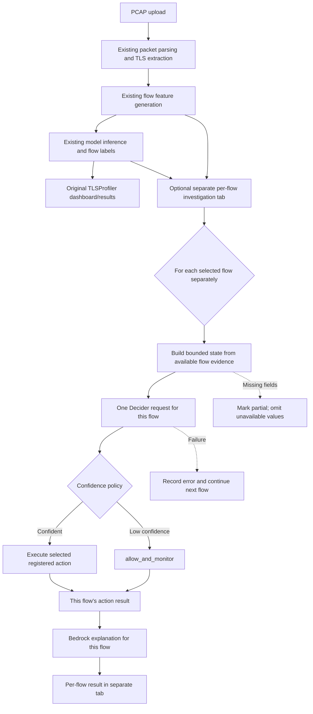

# TLSProfiler

**Behavioral profiling via TLS handshakes and network flow dynamics, with an optional per-flow Strands Decider 2B investigation.**

> Hackathon tags: **#strands-decider-2b #tool-selection**

TLSProfiler remains the primary application and pipeline: PCAP upload, packet parsing, TLS metadata extraction, per-flow feature generation, existing model training/evaluation and flow classification/labeling, and the original results dashboard are preserved. The Decider and Bedrock integration is an optional, separate tab that runs after existing flow results are available.

## Problem

Encrypted network sessions still expose useful metadata: TLS handshake fields, hostnames where SNI is visible, packet/byte counts, directionality, and timing. Analysts often need to decide whether to inspect TLS, a hostname, flow behavior, or an external reputation source. A generative model is not needed for every repeated choice.

## What the agent does

1. Runs the existing TLSProfiler pipeline on a PCAP or selected capture.
2. Retains the profiler's TLS/JA3/SNI extraction, per-flow features, model output, labels, charts, and reports.
3. Lets the user select one or more flow rows in the optional investigation tab.
4. Sends each selected flow separately to Strands Decider 2B to ask: **“Which investigation tool should the security agent run next for this flow?”**
5. Executes the selected registered action per flow. A low-confidence decision uses `allow_and_monitor`.
6. Sends each action result to Amazon Bedrock Converse for a separate explanation of that flow.

The original ML classifier answers **“What does this flow look like?”** Decider answers **“What should the agent do next for this flow?”** Bedrock explains the result. It does not decide or override the tool choice. A PCAP is never sent as one Decider request.

## Architecture



More detail is in [docs/architecture.md](docs/architecture.md).

## Why Decider 2B

The typed choice question maps incident evidence to one of five bounded actions: `tls_analyzer`, `dns_analyzer`, `flow_analyzer`, `reputation_checker`, or `allow_and_monitor`. Its output changes the program's control flow: the agent dynamically looks up and runs the selected tool. The UI exposes the choice, confidence, returned probabilities, model latency (when supplied by the service), and measured HTTP request latency.

## Why Amazon Bedrock

Bedrock is used for the generative task: a short, analyst-facing explanation after the investigation tool has run. The prompt instructs it to distinguish observed evidence from interpretation and not to invent reputation findings. The Converse call bounds output with `maxTokens=450`.

## Decision pattern: #tool-selection

**Input:** concise structured evidence for one individual flow.  
**Output:** one allowed tool, confidence, probabilities, and latency metadata.  
**Wiring:** `app.py` → `flow_batch.py` → `InvestigationAgent` → dynamic tool registry → action for that flow.  
**Low confidence:** executes `allow_and_monitor`; no retry loop or unbounded Decider/Bedrock round trip.

Reusable code and instructions:

- [patterns/security_tool_selection.py](patterns/security_tool_selection.py)
- [docs/decision-pattern.md](docs/decision-pattern.md)

## Setup

Requirements: Python 3.10+, an available Strands Decider System One endpoint, and Amazon Bedrock model access in the configured AWS region. No AWS resources are created by this project.

From the `tls-profiler` directory:

```bash
python -m venv .venv
source .venv/bin/activate
pip install -r ../requirements.txt
cp .env.example .env
```

The app automatically loads settings from `tls-profiler/.env` at startup (using `python-dotenv`). Copy `.env.example` to `.env` if needed, then fill in `BEDROCK_MODEL_ID` and `AWS_DEFAULT_REGION` there once. Do not add AWS access keys or tokens to this file; use your normal AWS credential provider, such as `aws login`, an AWS CLI profile, or an IAM role. `.env` and PEM files are ignored by Git. `DECIDER_URL` remains supported as a compatibility alias for `DECIDER_API_URL`. The existing TLSProfiler workflow does not require either AI service; only the optional investigation tab does.

## Local development with remote Decider

The Strands Decider 2B service runs privately on EC2, bound to EC2 localhost at port `8099`. For local development, create an SSH local-forward from your workstation to that EC2 loopback listener. The Streamlit app continues to call `http://127.0.0.1:8099/v1/systemone`; SSH securely forwards that local connection to EC2. The Decider stays private, and port `8099` must not be opened to the internet.

Open a dedicated terminal on your local machine and run:

```bash
ssh -i <path-to-key.pem> \
  -L 8099:127.0.0.1:8099 \
  ubuntu@<EC2_PUBLIC_IP>
```

Keep this SSH session open while using the app. The app defaults to the tunnel URL, or you can override it before launching Streamlit:

```bash
export DECIDER_API_URL=http://127.0.0.1:8099/v1/systemone
```

The client sends a JSON `POST` to `/v1/systemone` containing the flow-specific `state` and a typed `choice` question named `tool`, with the options `tls_analyzer`, `dns_analyzer`, `flow_analyzer`, `reputation_checker`, and `allow_and_monitor`. The response parser reads the selected choice, confidence, probabilities, top-level model `latency_ms`, and the measured total HTTP request latency.

To verify that the tunnel and API are working, run this from another local terminal. It makes one small test decision:

```bash
curl --fail --show-error --silent \
  -X POST http://127.0.0.1:8099/v1/systemone \
  -H 'Content-Type: application/json' \
  --data '{
    "state": "Flow evidence: destination_ip=203.0.113.5; packet_count=4. Test request only.",
    "questions": {
      "tool": {
        "type": "choice",
        "instructions": "Which investigation tool should the security agent run next?",
        "criteria": {
          "tls_analyzer": "Analyze TLS handshakes, TLS versions, cipher suites, JA3, ALPN, SNI, certificates and encrypted connection behavior.",
          "dns_analyzer": "Analyze domains, hostnames, DNS-related behavior, SNI names and suspicious domain patterns.",
          "flow_analyzer": "Analyze packet counts, byte counts, connection duration, directionality and repeated network-flow behavior.",
          "reputation_checker": "Check whether an unfamiliar IP, hostname or domain should be investigated for reputation or threat intelligence.",
          "allow_and_monitor": "Use when evidence is weak and no immediate investigation is justified."
        }
      }
    }
  }'
```

The response should include `answers.tool.choice`, `answers.tool.confidence`, `answers.tool.probabilities`, and a model `latency_ms`. If the app reports **Connection refused** or says Decider is unavailable, the usual cause is that the SSH tunnel is not running, the local port `8099` is occupied, or the EC2 service is not listening. Start/check the tunnel and the service; do not solve this by exposing port `8099` publicly. A tunnel alone does not configure Bedrock access; Bedrock explanation generation separately requires an enabled model, AWS credentials via the standard credential chain, and `bedrock:InvokeModel` permission.

### Bedrock IAM

Use the EC2 instance profile or another standard AWS credential provider. Do not put access keys in source files, `.env`, or this README. Grant only `bedrock:InvokeModel` for the chosen model or inference-profile ARN in the region in use; add `bedrock:InvokeModelWithResponseStream` only if you later implement streaming. The agent uses `bedrock-runtime` `Converse` and does not need Bedrock control-plane permissions.

Choose and verify a current model ID that is enabled in your region, then set `BEDROCK_MODEL_ID`. The code deliberately has no assumed default model ID. AWS errors, including missing permissions, are surfaced in the UI.

## Run the app

```bash
streamlit run app.py
```

Use the normal capture upload or sample capture, then open **Per-Flow Decider Investigation**. Select one or more flow IDs and start the optional agent stage. Each selected row makes its own Decider request and its own Bedrock request after a successful decision/action. Results are shown in that tab; all original profiler tabs remain available. Select one flow first to validate connectivity; selecting all flows can take longer and makes one model request per selected row.

## EC2 setup

On the existing Ubuntu EC2 instance, install the Python requirements in a virtual environment and run the app locally:

```bash
cd /path/to/tls-profiler
python3 -m venv .venv
source .venv/bin/activate
pip install -r ../requirements.txt
export DECIDER_API_URL=http://127.0.0.1:8099/v1/systemone
export BEDROCK_MODEL_ID=<model-id-enabled-in-your-region>
export AWS_DEFAULT_REGION=<your-region>
systemctl status strands-decider
streamlit run app.py --server.address 127.0.0.1 --server.port 8501
```

The Decider and dashboard stay bound to loopback. To view the dashboard from a workstation, use an SSH local forward such as `ssh -L 8501:127.0.0.1:8501 ubuntu@<ec2-host>` and open `http://127.0.0.1:8501`. Restrict SSH access to trusted source addresses; do not open the Decider or Streamlit port to the public internet. Attach a least-privilege instance profile for Bedrock; no access keys are needed in the environment.

For a persistent deployment, deployment alternatives, `systemd` service setup,
private browser access, Docker networking notes, and HTTPS options, see
[EC2 hosting options](docs/ec2-hosting-options.md). The recommended starting
point is native Python under `systemd` on the same EC2 instance as Decider,
with Streamlit kept on loopback and accessed through SSM or SSH port
forwarding.

## Existing TLSProfiler pipeline

Reusable modules include:

- `src/pcap_parser.py`: Scapy packet parsing and basic IP/TCP/UDP metadata.
- `src/tls_features.py`: TLS version, ClientHello/ServerHello, JA3/JA3S, SNI, domain entropy, and handshake counts.
- `src/flow_generator.py`: bidirectional flow aggregation, byte/packet direction, duration, and inter-arrival features.
- `src/predict.py` and `models/`: existing Random Forest prediction artifacts (when present).
- `app.py`: original multi-tab Streamlit profiler dashboard with an additive per-flow agent tab.

The optional investigation reads flow rows and the corresponding prediction rows already produced by the original dashboard pipeline. It does not replace or rerun the existing PCAP pipeline. Incomplete flows are submitted with the available fields; missing core features are identified and omitted rather than invented.

Existing extractor limitations: it does not currently provide a DNS transaction history, certificate chain, ALPN, named cipher suites, or destination history. The corresponding tools report only fields that are actually available and do not infer reputation or history.

## Measured performance

No live Decider or Bedrock request was available in this workspace, so this implementation does **not** claim a new latency, cost, accuracy, or AWS bill measurement. The supplied project context reports prior warm CPU Decider decisions around **2.7–4.5 seconds**; that figure is not a benchmark of this app.

Run the scenario evaluator against the real Decider endpoint to measure actual choices and latencies:

```bash
python scripts/evaluate_scenarios.py --output evaluation-results.json
```

The output records each independent scenario choice, confidence, probabilities, model latency if returned, HTTP latency, client elapsed time, and whether it matched the documented expected tool. It labels the result as a small scenario check, not general accuracy. Do not publish an accuracy or cost claim without running the corresponding measurement. `evaluation-results.json` is ignored by Git.

## Security and privacy

- PCAP upload data is processed locally and not sent to Bedrock; only bounded structured incident evidence and tool results are included in the explanation request.
- The app does not decrypt TLS payloads or call an external reputation service by default.
- No credentials are embedded. Prefer instance roles and least privilege.
- Demo addresses use documentation-only IP ranges and `.test` hostnames.
- Captures, datasets, model artifacts, temporary output, caches, and secrets are ignored by Git.
- Treat all PCAPs as potentially sensitive; only use data you are authorized to analyze.

## Repository structure

```text
tls-profiler/
├── src/                     # Existing TLSProfiler modules
│   └── decider_agent/       # Per-flow state, clients, orchestration, tools
├── patterns/                # Reusable #tool-selection recipe
├── tests/                   # Local automated tests (no AWS calls)
├── scripts/                 # Scenario evaluation
├── docs/                    # Architecture, article, pattern, demo script
├── app.py                   # Original TLSProfiler dashboard + optional per-flow tab
└── requirements.txt         # Dependencies are currently maintained at workspace root
```

## Tests

```bash
python -m unittest discover -s tests -v
```

Tests mock the Decider and Bedrock calls; they do not require AWS credentials or a running Decider service. A real end-to-end demo requires both services.

## Limitations and future work

- The Decider client currently expects a JSON System One endpoint at `/v1/systemone` with the documented request and a typed choice/confidence response. Verify that exact contract against your EC2 service before running live calls.
- If your Decider service requires a custom authentication header/token or different payload format, the current client does not yet send it; provide its auth and JSON contract so it can be added safely.
- The demo and tests validate orchestration, not threat-detection quality.
- The included reputation tool reports `provider_not_configured` unless a real provider is explicitly injected.
- Decider response parsing expects a System One choice answer with a choice and calibrated confidence; unsupported response shapes fail visibly.
- The existing classifier's training data and model artifacts are not part of this public-ready source tree. Use the original TLSProfiler training/data workflow if you need to reproduce its ML score.
- Add DNS packet parsing, certificate metadata, ALPN, and a real provider only when supported by validated evidence and credentials.

## Submission assets

- [Builder Center article draft](docs/builder-center-article.md)
- [Under-three-minute demo script](docs/demo-script.md)
- [Architecture](docs/architecture.md)
- [Reusable decision pattern](docs/decision-pattern.md)

Before publication, confirm the repository license and contribution/attribution permissions for the existing TLSProfiler code and datasets. No license is added here because the workspace did not specify one.
