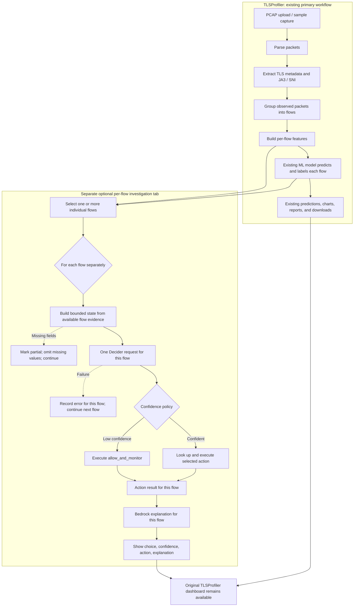

# Architecture

## Data and decision flow

## Responsibilities

| Component | Responsibility | Does not do |
|---|---|---|
| TLSProfiler | Extract metadata, derive flow features, optionally classify/label flows, display its original results | Select agent tools or generate explanations |
| State builder | Normalize each individual flow, mark absent core fields, and bound that flow's model input | Add evidence not found in the input or treat missing values as zero |
| Strands Decider 2B | Choose one next investigation action per flow with confidence | Make one decision for the entire PCAP, generate a narrative, or run a tool |
| Investigation tools | Inspect only their relevant structured evidence | Claim facts not present or configured |
| Amazon Bedrock | Explain the decision and tool output | Override Decider's choice |
| Streamlit | Show evidence, selection, confidence, tool result, and explanation | Simulate the external services |

## Per-flow and incomplete-flow policy

The new tab sends one separate Decider request for each selected flow and one Bedrock explanation for each successful decision/action. It does not combine the PCAP into one decision or select only one “most suspicious” flow. The user can select individual flows or all rows. Each request includes its Flow ID and only that row's evidence and corresponding existing ML prediction.

Captured traffic may start or stop mid-flow. Missing or blank fields are omitted, identified as partial evidence, and are not substituted with zero. A flow with partial fields is still submitted when possible. A Decider failure is recorded for that flow and processing continues with the next one. If Bedrock is unconfigured or fails, the completed Decider decision and action output remain visible alongside the explanation error.

If confidence is below `DECIDER_CONFIDENCE_THRESHOLD` (default `0.55`), the selected action is recorded but not executed. The registry runs `allow_and_monitor` for that flow. There is no retry or model-to-model loop.

## Evidence boundaries

The existing extractor currently supplies TLS version, JA3/JA3S hashes, SNI, domain entropy, packet and byte counts, direction, flow duration, and inter-arrival values. It does not supply DNS transaction history, certificate chains, ALPN, named cipher-suite values, or a historical destination inventory. Tools state when their evidence is missing. The default reputation provider is unconfigured and makes no threat claim.

## Timing and request volume

The Decider client measures HTTP round-trip time with a monotonic clock and reports model latency only if the endpoint includes it. End-to-end UI timing includes preprocessing and Bedrock. Investigating N selected flows can make N Decider and up to N Bedrock calls; the UI states this before running. No timings in this repository are presented as live benchmarks; run `scripts/evaluate_scenarios.py` and the UI against the configured services to measure them.
